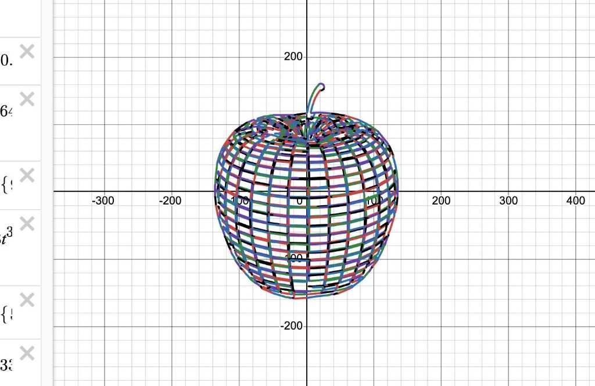
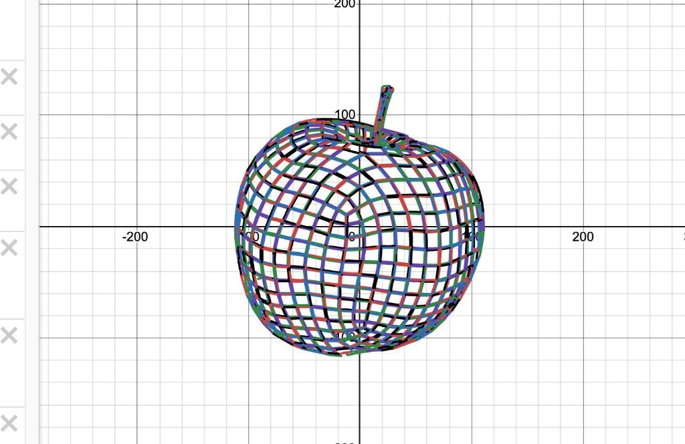

# Desmos Draw

Turns regular images into mathematical graphs for Desmos. Upload an image, adjust the settings, and get formulas that you can copy and paste directly into [Desmos](https://www.desmos.com/calculator).

Instead of pixels, it uses separate lines, circles, arcs, and curves. Each shape has its own equation.

**Demo:** https://desmosdraw.vercel.app/

**GitHub:** https://github.com/qweqqae

| | |
|:---:|:---:|
|  |  |

## Getting Started

```bash
npm install
npm run dev
```

Open the local URL from your terminal, upload an image, and adjust the settings. Use **Copy formulas** to copy the generated equations

To build run `npm run build`.

## How It Works

The app detects image contours and tries to fit mathematical functions to them. You can adjust the accuracy, scale, sensitivity, and choose which types of shapes to use

There are two modes:

**Line art** for drawings and clear outlines
**Photo** for regular photographs

You can erase unwanted lines directly in the edges editor

Conversion isn't always perfect, especially with complex photos. More details mean more equations, and Desmos might slow down if there are too many...

The built-in preview uses the same coefficient rounding as the exported formulas, so the result should match what you paste into Desmos

## Tech Stack

React, Vite, JavaScript.

Image processing runs in a Web Worker

The main vectorization code in src/lib/vector/
